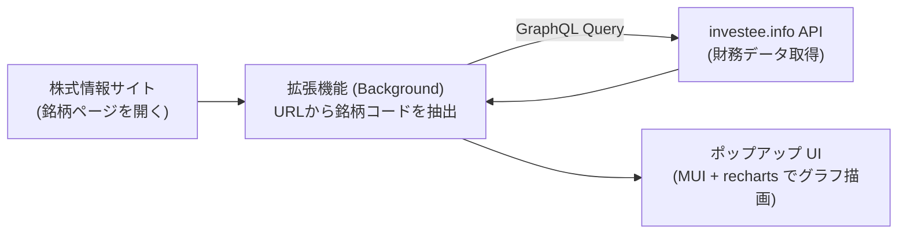

# investee Chrome 拡張機能

株式情報サイトの銘柄ページを開いた際に、ワンクリックでその企業の財務三表（貸借対照表・損益計算書・キャッシュフロー計算書）、過去 5 年のフリー CF と ROE・ROA をポップアップ表示するブラウザ拡張機能です。

データは [investee.info](https://investee.info) の GraphQL API から取得し、見やすいグラフとして描画します。

## 対応サイト

以下のサイトで銘柄ページを開くと拡張アイコンがアクティブになり、ポップアップで財務三表を確認できます。

| サイト             | ドメイン                                            |
| ------------------ | --------------------------------------------------- |
| 株探               | `kabutan.jp`                                        |
| みんかぶ           | `minkabu.jp`                                        |
| Yahoo!ファイナンス | `finance.yahoo.co.jp`                               |
| 四季報オンライン   | `shikiho.toyokeizai.net`                            |
| バフェット・コード | `www.buffett-code.com`                              |
| 楽天証券           | `www.rakuten-sec.co.jp`、`member.rakuten-sec.co.jp` |

## 仕組み



## 技術スタック

| 用途                 | 使用するもの                                |
| -------------------- | ------------------------------------------- |
| フレームワーク・言語 | React、TypeScript                           |
| 状態管理・通信       | Redux Toolkit、Apollo Client (GraphQL)      |
| UI・チャート         | MUI、recharts                               |
| ビルド               | Vite、CRXJS (@crxjs/vite-plugin)            |
| 拡張機能の仕様       | Manifest V3 (Chrome)、Manifest V2 (Firefox) |

## 開発環境と動作確認

### 1. 依存パッケージのインストール

```bash
yarn install
```

### 2. 開発用ビルドの生成

```bash
# 開発モードでビルド（localhost:20000 への接続に対応）
yarn vite build --mode development
```

### 3. Chrome への読み込み

1. Google Chrome を開き、アドレスバーに `chrome://extensions` を入力して開きます。
2. 画面右上の **「デベロッパーモード」** を ON にします。
3. **「パッケージ化されていない拡張機能を読み込む」** をクリックし、本リポジトリの `dist/` ディレクトリを選択します。
4. 対応サイト（例: `https://kabutan.jp/stock/?code=7203`）を開き、拡張アイコンをクリックして動作を確認します。
5. 拡張機能のカードに **「エラー」** ボタンが出ていないことを確認します。出ている場合は押して内容を確認します。

ビルドし直して `dist/` を差し替えたら、ポップアップを開く前に拡張機能のカードの再読み込みボタン（↻）を押してください。Chrome は読み込み済みの service worker を使い続けるため、押さずに開くと新しいポップアップが古い service worker と組み合わさり、変更が反映されなかったり、ポップアップが空白になったりします。Chrome を再起動しても反映されないことがあります。再読み込みの前に開いて記録されたエラーは再読み込み後も残るので、「エラー」画面の **「すべて削除」** で消してから確認し直してください。

エラーが記録されるかは読み込み方で変わります。記録されていない間は、カードの「エラー」ボタンも `chrome.developerPrivate.getExtensionsInfo` の `runtimeErrors` も空のままです。

| 読み込み方                                                                     | エラーの記録                                                                                                                                                   |
| ------------------------------------------------------------------------------ | -------------------------------------------------------------------------------------------------------------------------------------------------------------- |
| デベロッパーモードを ON にして「パッケージ化されていない拡張機能を読み込む」   | 記録される                                                                                                                                                     |
| Chrome を `--load-extension` 付きで起動する（Playwright などの自動操作で使う） | デベロッパーモードを ON にしても記録されない。拡張機能の「詳細」で **「エラーを収集する」** を ON にしてから再読み込みすると、起動時のエラーも含めて記録される |

### 4. 複数データでのポップアップ表示確認

拡張を読み込まずに、ポップアップを普通のタブで表示して確認できます。

```bash
yarn preview:popup
```

[localhost:8302](http://localhost:8302/) を開き、表示するデータを選びます。

| データ     | 選び方                                                   | 内容                                                                                                                                                                                                               |
| ---------- | -------------------------------------------------------- | ------------------------------------------------------------------------------------------------------------------------------------------------------------------------------------------------------------------ |
| 固定データ | 「確認データ」で選ぶ                                     | 架空の企業で、金額は API と同じ円。黒字の 2 年度、赤字・債務超過、IFRS・企業公表 ROE、ゼロ・百万円未満・欠損年、長い企業名・未対応形式と、これらをまとめた全固定データ。空の取得結果・読み込み中・取得失敗も選べる |
| 実決算     | 証券コードをカンマ区切りで入力し、「実決算を取得」を押す | financial-statement のローカル API から取得する。先にローカル API を起動しておく。クエリと接続先は拡張本体と同じ定義を使う                                                                                         |

固定データの貸借・PL の左右合計、CF の期首と期末、フリー CF と指標の計算の整合性はテストで確かめています。

確認用ページが実際のポップアップをどこまで再現するかは次のとおりです。

| 項目                                            | 確認用ページ                                                                                                             |
| ----------------------------------------------- | ------------------------------------------------------------------------------------------------------------------------ |
| 画面（Popup・Redux・CSS・ポップアップ HTML）    | 拡張本体と同じものを使う                                                                                                 |
| 窓の大きさ                                      | 実際と同じ 448×600px の窓の中でスクロールする。狭い画面では窓ごと横へスクロールできる                                    |
| 本文の文字の大きさとフォント                    | Chrome が拡張のページに入れるスタイルを再現する。フォントは日本語の macOS の値のため、ほかの環境では実際と違うことがある |
| background の銘柄検知・Chrome API・永続化・権限 | 確かめられない。拡張を読み込んで確認する                                                                                 |
| 利用状況の送信                                  | 送信しない                                                                                                               |

変更前のソースを別ディレクトリに用意すると、`POPUP_PREVIEW_SOURCE=/path/to/before/src yarn preview:popup --port 8304` で同じ確認データを使って変更前と比べられます。

## 主なコマンド

```bash
yarn dev       # Vite の開発サーバ起動（HMR）
yarn build     # 本番用ビルド（Chrome用 dist/ と Firefox用 dist-firefox-v2/ を生成）
yarn test      # テストの実行
yarn lint      # oxlint・Prettier・型チェックによる静的検証
yarn compile   # GraphQL スキーマから TypeScript 型を再生成
yarn preview:popup  # ポップアップの表示確認ページを起動（localhost:8302）
```

## ディレクトリ構成

```text
financial-statement-chrome-extension/
├── src/
│   ├── background/          # 銘柄ページ検知、銘柄コード抽出、API通信
│   ├── popup/               # ポップアップの画面レイアウト、カルーセル表示
│   ├── shared/              # Web版と共有する財務グラフ・指標の表示コンポーネント
│   ├── store/               # Redux store 定義、background とポップアップの間の状態の受け渡し
│   └── manifest.mts         # 拡張機能のマニフェスト定義 (MV3)
├── tools/
│   ├── popup-preview/       # 複数データでのポップアップ表示確認（yarn preview:popup）
│   └── unstable_mv3ToMv2Build.mjs  # Firefox 用の MV2 への変換（yarn build で実行）
├── docs/                    # 計測ガイド、リリース手順
└── vite.config.mts          # ビルド設定
```

## 利用状況の分析

イベントの定義・GA4 の見方・計測停止設定は [計測ガイド](docs/analytics.md) を参照してください。

## ライセンス

All rights reserved です。著作権者の書面による許可なく、このリポジトリのコードを利用・複製・改変・再配布することはできません。詳細は [LICENSE](LICENSE) を参照してください。

このリポジトリは [browser-extension-react-typescript-starter](https://github.com/sinanbekar/browser-extension-react-typescript-starter) を元に作成しており、そのテンプレートに由来する部分は MIT License に従います。全文は [THIRD_PARTY_NOTICES](THIRD_PARTY_NOTICES) を参照してください。
